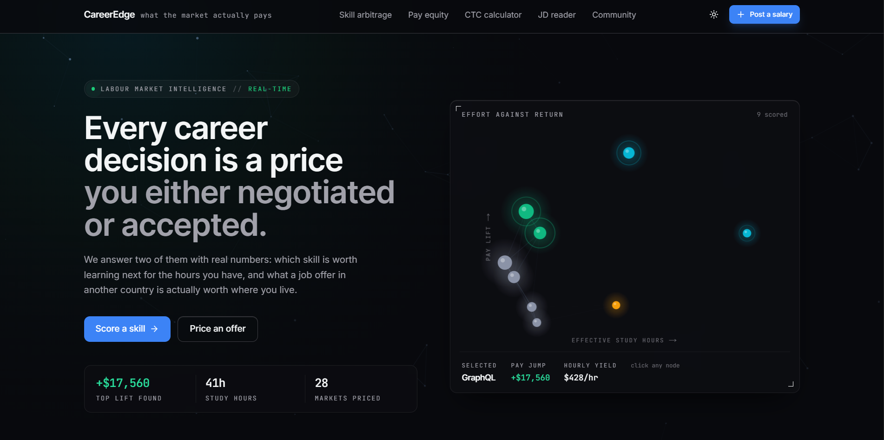
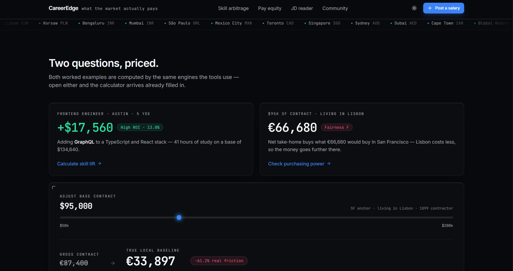

# CareerEdge

Career intelligence platform: two calculators that price career decisions, a community where those calculations get reviewed, and the monetization layer that funds it.

- **Skill Arbitrage** (`/tools/skill-arbitrage`) — ranks every skill worth adding by salary lift per hour of study
- **Remote Pay Equity** (`/tools/remote-pay-equity`) — converts a cross-border offer into local purchasing power
- **Community** (`/community`) — threaded, pseudonymous discussion with live calculation embeds





---

> **Next.js 15.** This project targets Next 15, where `cookies()`, `params` and
> `searchParams` are async. If you are upgrading an older checkout, run
> `npm install` before `npm run dev` or the dynamic routes will throw.

## Running it locally

You need Node 18.18+ and a PostgreSQL database. [Neon](https://neon.tech) and [Supabase](https://supabase.com) both have free tiers that work.

```bash
npm install
cp .env.example .env        # then fill in DATABASE_URL and DIRECT_URL
npx prisma generate
npm run db:push             # creates the schema
npm run db:seed             # users, five threads, nested comments, partners
npm run dev
```

Open http://localhost:3000. The seed creates a demo account (`throwaway_dev`) that `lib/session.ts` resolves by default, so posting and voting work immediately without wiring up auth.

### Environment variables

| Variable | Required | What it does |
| --- | --- | --- |
| `DATABASE_URL` | yes | Pooled Postgres connection used by the app |
| `DIRECT_URL` | yes | Unpooled connection Prisma needs for migrations |
| `NEXT_PUBLIC_APP_URL` | no | Absolute URL for metadata and share links |
| `NEXT_PUBLIC_AFFILIATE_TAG` | no | Appended as `?ref=` on partner outbound links |
| `NEXT_PUBLIC_PRO_PAYWALL_ENABLED` | no | Set `false` to see gated data during development |

---

## Architecture

```
src/
├── app/
│   ├── page.tsx                       Landing — runs both engines at build time
│   ├── tools/skill-arbitrage/         Module A
│   ├── tools/remote-pay-equity/       Module B
│   ├── community/                     Feed, [slug] detail, new post composer
│   ├── reports/[id]/                  Print-ready gated report
│   └── api/
│       ├── calculations/              Persists runs (recomputed server-side)
│       ├── posts/  votes/             Community writes, transactional tallies
│       ├── leads/                     Gated-unlock capture
│       └── partner-click/             Affiliate attribution beacon
├── components/
│   ├── ui/                            shadcn/ui primitives
│   ├── tools/                         Calculators, quadrant matrix, skill picker
│   ├── community/                     Feed card, comment tree, composer, embeds
│   ├── monetization/                  PartnerCard, LeadCaptureModal, ProGate
│   └── layout/                        Header, footer, theme
├── lib/
│   ├── engines/                       Pure scoring functions, no I/O
│   ├── schemas.ts                     Zod — one source of truth for both layers
│   ├── moderation.ts                  PII/profanity screen + rate limiting
│   ├── community-queries.ts           Anonymity-safe server reads
│   └── session.ts                     Auth stub — swap for your provider
├── data/                              Roles, skills, markets, FX, partners
├── store/                             Zustand: run history, unlocks, Pro flag
└── types/                             Domain types
```

### How the engines work

Both live in `src/lib/engines/` as pure functions. They take a validated input, read from the static datasets in `src/data/`, and return a typed result. No database, no fetch, no React — which means they run identically at build time on the landing page, in the browser for instant results, and on the server when persisting a snapshot.

**Skill arbitrage.** For each skill not already in your stack:

```
liftPct        = baseLift × roleAffinity × scarcity × seniorityFactor
effectiveHours = publishedHours × prerequisiteFactor × learningFactor
arbitrageIndex = (baseSalary × liftPct ÷ effectiveHours) × 100
```

`scarcity` is what stops commoditised skills scoring well — it's driven by demand ÷ supply, so a skill 78% of candidates already list is priced as table stakes rather than a differentiator. `prerequisiteFactor` shortens the runway when your existing stack covers the dependencies.

**Remote pay equity.** Gross converts to USD, then deductions apply in order: FX spread → self-employment tax and forfeited benefits (contractor only) → unpaid leave → income tax. The headline "net effective value" multiplies net take-home by the ratio of anchor-market to living-market costs, answering: *what would someone in the anchor city need to earn to live this way?*

### Data provenance

`src/data/` ships static datasets so the app runs with no external dependencies. The figures are a realistic 2025 blend (levels.fyi, BLS OES, Numbeo-style indices) but they are **reference data, not a live feed**. In production, replace the module bodies with cached provider calls — the engines only depend on the exported shapes.

### What's deliberately left as a stub

- **Authentication.** `lib/session.ts` resolves the seeded demo user. Swap in NextAuth, Clerk, or Supabase Auth; every route depends only on the `SessionUser` contract.
- **Rate limiting store.** `checkRateLimit` uses an in-process Map, which resets per instance. Point it at Upstash Redis before running more than one server.
- **Blocked-term list.** `moderation.ts` ships with an empty `BLOCKED_TERMS` array on purpose — populate it from a maintained list at deploy time rather than committing a dictionary of slurs to the repo.
- **Checkout.** `ProGate` flips a store flag. Wire it to Stripe and check a real entitlement.
- **Report delivery.** `/reports/[id]` is a print-optimised page. If you need a PDF attached to an email, render it with Playwright or React-PDF in a background job.

---

## Deploying

### Vercel + Neon

1. Create a Neon project. Copy both the **pooled** connection string (ends in `-pooler`) and the **direct** one.
2. Push the repo to GitHub and import it in Vercel.
3. Set `DATABASE_URL` (pooled) and `DIRECT_URL` (direct) in Vercel's environment variables for all environments.
4. Deploy. The `build` script runs `prisma generate` before `next build`, which Vercel's build cache otherwise breaks.
5. Run migrations once against production:
   ```bash
   DATABASE_URL="<direct-url>" npx prisma migrate deploy
   ```
6. Seed if you want the demo content: `DATABASE_URL="<direct-url>" npm run db:seed`

### Vercel + Supabase

Identical, except Supabase gives you the pooled URL on port `6543` and the direct URL on `5432`. Use `6543` for `DATABASE_URL` and `5432` for `DIRECT_URL`.

### Deploying in five minutes

```bash
npm run build          # must pass locally first
git init && git add -A && git commit -m "Initial"
gh repo create careeredge --private --source=. --push
```

Then at vercel.com: **Add New → Project → import the repo**. Set `DATABASE_URL`
(pooled) and `DIRECT_URL` (direct) under Environment Variables for all
environments, and add `NEXT_PUBLIC_APP_URL` as your production URL so share
links and OG images resolve. Deploy.

Once it is live, run the migration and seed against production:

```bash
DATABASE_URL="<direct-url>" npx prisma migrate deploy
DATABASE_URL="<direct-url>" npm run db:seed
```

**Put the database in the region nearest your users.** A Neon project in
`us-east-2` serving traffic from South Asia adds roughly 250ms to every query,
and each page makes several. `ap-south-1` for an India-first audience.

### Before going live

- [ ] Replace the auth stub — right now every visitor is the same seeded user
- [ ] Move rate limiting to a shared store
- [ ] Populate `BLOCKED_TERMS` and add a moderation queue for `FLAGGED` posts
- [ ] Swap static datasets for a live compensation and FX feed
- [ ] Add `prisma migrate` history instead of `db push`
- [ ] Confirm affiliate disclosures meet FTC requirements in your markets

---

## Scripts

| Command | Does |
| --- | --- |
| `npm run dev` | Development server |
| `npm run build` | `prisma generate` then production build |
| `npm run typecheck` | `tsc --noEmit`, strict mode |
| `npm run db:push` | Sync schema without a migration |
| `npm run db:migrate` | Create and apply a migration |
| `npm run db:seed` | Load demo users, threads and partners |
| `npm run db:studio` | Prisma Studio |

---

## A note on the numbers

Compensation figures are modelled medians, tax lines are blended effective rates for planning, and cost indices are city-level. None of it is advice, an offer, or a substitute for an accountant in your jurisdiction. The disclaimers in the footer and under the pay equity results say the same thing to users — keep them there.
